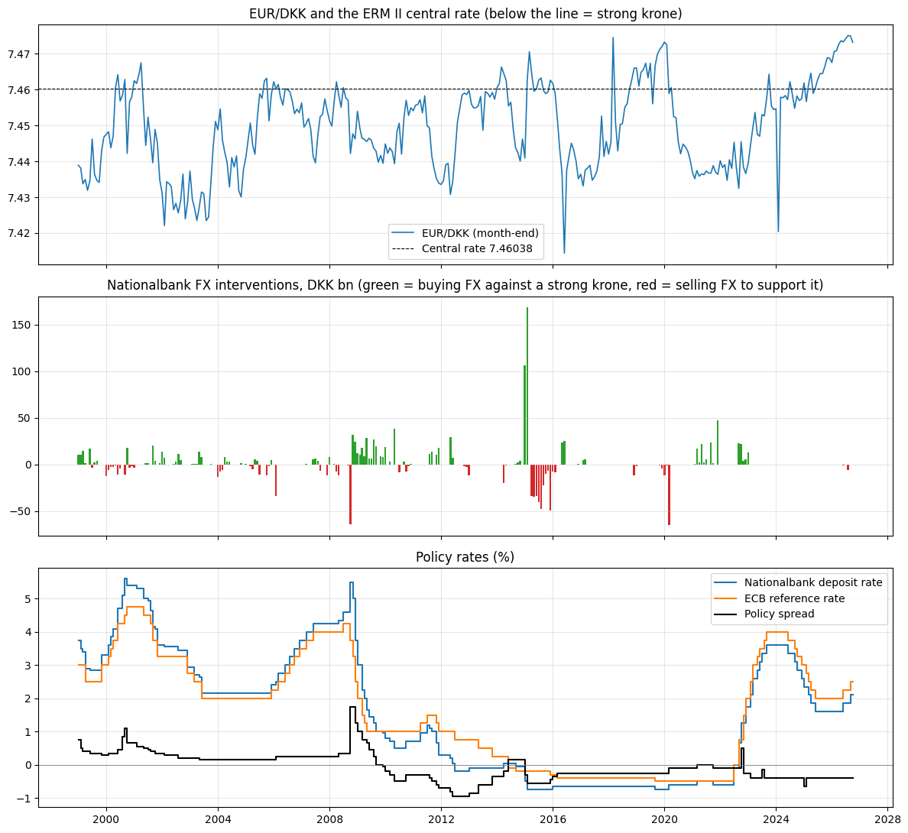
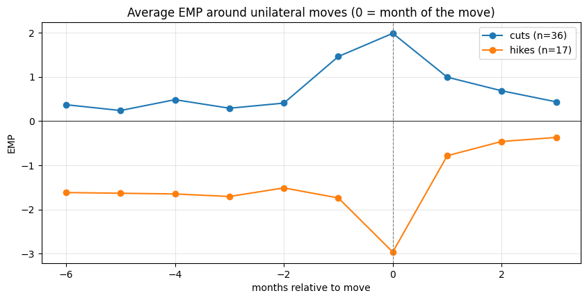

# Predicting The NationalBank

**Can exchange-market pressure predict Danmarks Nationalbank's unilateral interest-rate decisions? Evidence from 1999–2026**

## Abstract

Denmark has pegged the krone to the euro within ERM II since 1999. Danmarks Nationalbank normally mirrors the ECB's rate decisions. When the krone comes under pressure, it first intervenes in the foreign-exchange market and, if pressure persists, changes its policy rate unilaterally. Using daily policy rates, I identify 53 unilateral moves between January 1999 and October 2026 (36 cuts and 17 hikes). I then build an exchange-market pressure index from the deviation of EUR/DKK from its central rate and from the Nationalbank's monthly interventions, using only information available at each date. Pressure at the end of the preceding month has the expected sign in 38 of the 43 moves for which the index is available, including all 13 hikes. It significantly predicts the probability of a unilateral cut (logit t-statistic 4.7) and of a unilateral hike (t-statistic −3.1) in the following month. The signal works best for cuts that follow a build-up of interventions. It fails when the shock and the response fall within the same month, as with the four cuts that followed the Swiss National Bank's removal of its EUR/CHF floor in January 2015.

*Figure 1. Top: EUR/DKK at month-end and the ERM II central rate of 7.46038. Middle: Nationalbank FX interventions, net purchases of foreign exchange in DKK billion. Bottom: Nationalbank deposit rate, ECB reference rate and the policy spread.*

## 1. Background

**The peg.** Denmark participates in ERM II with a central rate of 7.46038 kroner per euro and a formal band of ±2.25%, but in practice the krone is kept much closer to the central rate. Monetary policy has a single objective, the exchange rate. The Nationalbank has no independent inflation target.

**The reaction function.** In normal times the Nationalbank changes its rates when the ECB does, keeping the policy spread constant. Under pressure it acts in sequence. It first intervenes, selling kroner against a strong krone or buying them against a weak one. If pressure persists, it changes the spread: a unilateral cut to discourage inflows, or a unilateral hike to defend the krone.

**Why this is predictable in principle.** The reaction function is narrow and its inputs are observable: the exchange rate daily, and interventions monthly, before most rate decisions. The Nationalbank's own analysis finds that its interventions are effective in stabilising the krone (Danmarks Nationalbank, 2016). The exchange-market pressure literature (Girton & Roper, 1977; Eichengreen, Rose & Wyplosz, 1996) combines exchange-rate movements, reserve changes and interest-rate changes into one index of pressure on a currency. Under a hard peg, pressure is absorbed by interventions and eventually by interest rates. The interest-rate component is therefore excluded here, since it is the outcome to be predicted.

## 2. Data and Methodology

**Data.**

| Series | Source | Frequency |
|---|---|---|
| Nationalbank rate on certificates of deposit (`DNRENTD`) | Statistics Denmark | Daily |
| Nationalbank FX interventions, net purchase of foreign exchange (`DNSNB2`) | Statistics Denmark | Monthly |
| EUR/DKK, from DKK per USD and USD per EUR (`DEXDNUS`, `DEXUSEU`) | FRED | Daily |
| ECB main refinancing rate and deposit facility rate (`ECBMRRFR`, `ECBDFR`) | FRED | Daily |

**ECB reference rate.** The Nationalbank rate is compared with the ECB main refinancing rate until May 2014 and with the deposit facility rate from June 2014, when ample excess liquidity made the deposit rate the anchor of euro money-market rates. FRED's main refinancing rate covers fixed-rate tenders only and does not move between June 2000 and October 2008, when the ECB used variable-rate tenders. Over that period the ECB corridor was symmetric, so the main refinancing rate is reconstructed as the deposit rate plus one percentage point.

**Unilateral moves.** These are measured on daily data as the change in the Nationalbank rate minus the change in the ECB reference rate. Two adjustments are made:
- Short-lived deviations that are subsequently reversed are removed. These arise when the two central banks implement the same decision a few days apart; for example, the Nationalbank raised rates by 0.60 points on 28 October 2022 and the ECB by 0.75 points on 2 November 2022, a unilateral move of −0.15 points. Consecutive moves in the same direction are kept separately.
- The technical adjustment of the Nationalbank's instruments on 19 March 2021 is excluded.

Daily moves are summed by month.

**Exchange-market pressure.** The index is
$$\text{EMP}_t = z(-\text{deviation}_t) + z(\text{interventions}_t)$$
where the deviation is the percentage gap between EUR/DKK and the central rate, and $z(\cdot)$ standardises with an expanding window, so that each value uses only past data. Positive values indicate appreciation pressure, and therefore an expected cut; negative values indicate depreciation pressure, and an expected hike.

**Tests.** Pressure at the end of month *t* is related to unilateral moves in month *t+1* through an event-time profile, a predictive regression with Newey-West standard errors, logit models for cuts and hikes, and a warning rule evaluated by precision and recall.

## 3. Results

*Figure 2. Average exchange-market pressure in the months around unilateral cuts and hikes. Month 0 is the month of the move.*

Pressure rises sharply in the month before unilateral cuts, from about 0.4 to 1.5, and peaks in the month of the cut. Before hikes, depreciation pressure is persistent, at around −1.6 for at least six months, and intensifies to −3.0 in the month of the hike. After each move, pressure falls back towards zero, consistent with the move relieving it.

**Table 1. Statistical tests: pressure at the end of month t, moves in month t+1, 2001–2026**

| Test | Coefficient | t-statistic | Fit | Events |
|---|---:|---:|---:|---:|
| Logit, probability of a unilateral cut | 0.61 | 4.68 | pseudo R² 0.15 | 30 |
| Logit, probability of a unilateral hike | −0.52 | −3.10 | pseudo R² 0.09 | 13 |
| Regression, size of next month's move (pp): EMP | −0.013 | −4.10 | R² 0.07 | 310 months |
| Regression, size of next month's move (pp): policy spread | −0.035 | −1.77 | | |

The negative coefficient on the spread indicates that a spread far from zero tends to be partly normalised later, although the effect is only marginally significant.

**Table 2. Warning rule: expect a move within three months when |EMP| exceeds a threshold**

| Threshold | Cuts: precision | Cuts: recall | Hikes: precision | Hikes: recall |
|---:|---:|---:|---:|---:|
| 1.0 | 48% | 58% | 25% | 76% |
| 1.5 | 52% | 50% | 26% | 53% |
| 2.0 | 50% | 36% | 21% | 35% |

*Precision is the share of warnings followed by a move in the predicted direction. Recall is the share of moves preceded by a warning.*

The rule is informative for cuts: about half of all appreciation warnings are followed by a cut within three months. It is weak for hikes, because depreciation pressure can persist for long periods without a unilateral response, as it has since 2024.

**Table 3. Selected episodes**

| Month | Move | Context | EMP at t−1 | Interventions in month (DKK bn) |
|---|---:|---|---:|---:|
| Oct 2008 | +140 bp | Defence of the krone after the Lehman collapse | −1.07 | −63.9 |
| Dec 2008 | −50 bp | Reversal as pressure eased | 3.27 | 24.7 |
| Jun 2012 | −15 bp | Safe-haven inflows during the euro crisis | 4.13 | 7.3 |
| Jan 2015 | −45 bp | Swiss National Bank removes the EUR/CHF floor | −0.06 | 106.3 |
| Feb 2015 | −25 bp | Continued speculative inflows | 9.18 | 168.7 |
| Jan 2016 | +10 bp | First hike after the 2015 inflows reversed | −4.12 | −7.7 |
| Mar 2020 | +15 bp | Krone weakens during the COVID-19 shock | −2.16 | −64.7 |
| Oct 2021 | −10 bp | Cut after FX purchases | 2.35 | 1.5 |
| Nov 2022 | −15 bp | Smaller hike than the ECB, strong krone | 1.48 | 3.7 |
| Feb 2023 | −15 bp | Smaller hike than the ECB, strong krone | 1.45 | 0.0 |

The full list of 53 moves is reported in the notebook.

**Stylised trade.** A position in the DKK–EUR short-rate spread proportional to the pressure index, taken only when |EMP| > 1, would have been positioned in the right direction ahead of 27 unilateral moves and in the wrong direction ahead of 2. It earns a cumulative 401 basis points over the sample (one-year duration). Because market rates partly anticipate the Nationalbank's moves, this is an upper bound on exploitable profit rather than a realistic P&L.

## 4. Discussion

**The Nationalbank's reaction function is visible in the data.** In 38 of 43 moves since 2001, pressure at the end of the preceding month pointed in the direction of the subsequent move, including all 13 hikes. Formal tests confirm that pressure predicts both the occurrence and the direction of unilateral moves.

**Cuts follow a build-up of interventions; hikes follow persistent weakness.** Appreciation pressure typically builds up quickly through large FX purchases before a cut, which makes cuts more predictable. Depreciation pressure is more persistent, and the Nationalbank tolerates it for longer before hiking, which reduces the precision of any warning rule for hikes.

**The main limitation is timing.** When a shock and the policy response occur within the same month, month-end data cannot anticipate the move. In January 2015 pressure was neutral at the end of December. The Swiss National Bank's decision on 15 January, record interventions and three cuts all followed within two weeks. The index registered the pressure only afterwards (9.18 at the end of January), in time to anticipate the fourth cut in February. A daily version of the index would address this.

## 5. Current Reading

At the end of October 2026, EUR/DKK stands at 7.473, 0.17% above the central rate on the weak side, and the Nationalbank sold foreign exchange in August. The policy spread is −0.40 percentage points and the pressure index is −2.04, indicating depreciation pressure. Historically, such readings have preceded unilateral hikes, but, as Table 2 shows, depreciation warnings have low precision, and pressure of this kind has persisted since 2024 without a unilateral move. This is a model output, not a recommendation.

## 6. Limitations

- **Few events.** 53 moves, of which 43 can be evaluated with the index, limit statistical power, especially for hikes.
- **Monthly frequency.** Part of the response falls within the same month as the pressure and cannot be predicted from month-end data.

## References

Danmarks Nationalbank (2016). Effects of Danmarks Nationalbank's interventions in the foreign exchange markets. *Monetary Review*, 4th Quarter 2016.

Eichengreen, B., Rose, A. & Wyplosz, C. (1996). Contagious currency crises: First tests. *Scandinavian Journal of Economics*, 98(4), 463–484.

Girton, L. & Roper, D. (1977). A monetary model of exchange market pressure applied to the postwar Canadian experience. *American Economic Review*, 67(4), 537–548.

Svensson, L. (1991). The simplest test of target zone credibility. *IMF Staff Papers*, 38(3), 655–665.

---

Mattia Mariani
